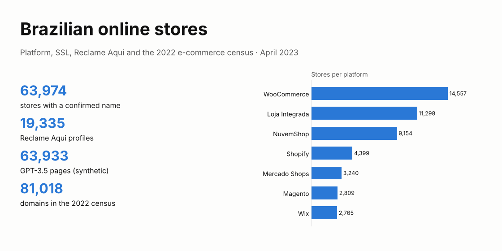
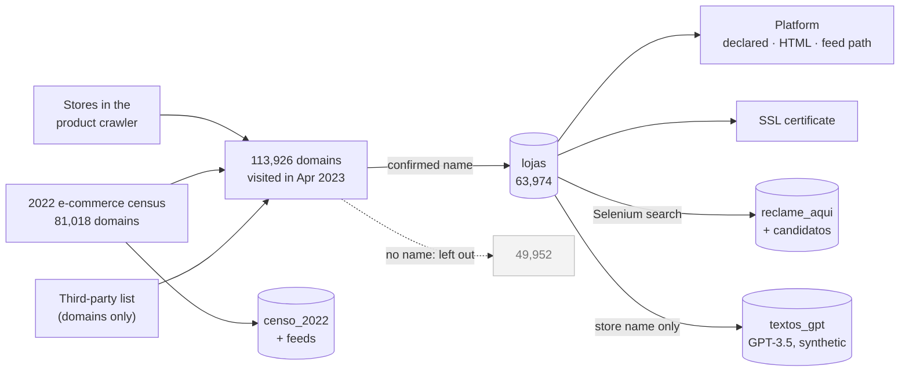
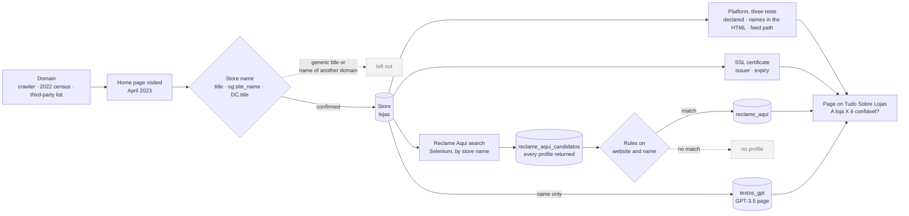
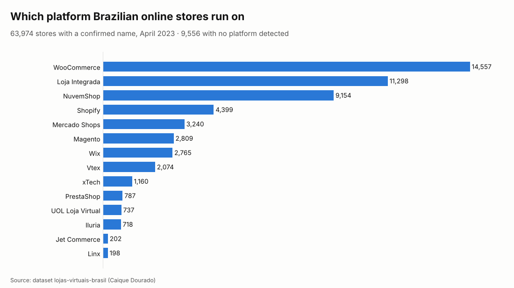

# Lojas virtuais do Brasil · Brazilian online stores

[](https://github.com/CaiqueDourado/lojas-virtuais-brasil/actions/workflows/validate.yml)
[](LICENSE-DATA.md)
[](LICENSE)
[](https://www.kaggle.com/datasets/caiquedourado/lojas-virtuais-brasil)

[Leia em português](README.pt-BR.md) · [The archived site](https://web.archive.org/web/20250618081809/https://tudosobrelojas.com/a-loja-saboreat-e-confavel-tudo-sobre-a-loja-saboreat/)



**63,974 Brazilian online stores** found and checked in April 2023: domain, e-commerce platform, catalog
size, SSL certificate and Reclame Aqui reputation. The dataset also has the **2022 e-commerce census** of
81,018 domains and their product feeds, and the **63,933 pages GPT-3.5 wrote** about the stores: a record of
what a language model says when it knows nothing about the subject.

## The site: tudosobrelojas.com (2023)

[](https://web.archive.org/web/20250618081809/https://tudosobrelojas.com/a-loja-saboreat-e-confavel-tudo-sobre-a-loja-saboreat/)

*Tudo Sobre Lojas, [archived on the Wayback Machine](https://web.archive.org/web/20250618081809/https://tudosobrelojas.com/a-loja-saboreat-e-confavel-tudo-sobre-a-loja-saboreat/).*

In 2023 the author ran **Tudo Sobre Lojas**, a site with one page per Brazilian online store, each answering
"A loja X é confiável?" ("Is store X reliable?"). This dataset is the database behind it.

| Part | How it worked | In this dataset |
|---|---|---|
| Pages | One per store: is it reliable, is it safe, benefits, payment and shipping, coupons, order tracking, customer service | Text in `textos_gpt` |
| Platform | Fingerprinting of the e-commerce platform (Shopify, VTEX, WooCommerce, NuvemShop…) by three tests | `lojas.plataforma`, `sinais_no_html`, census feeds |
| Security | SSL certificate checked for every store | `certificado_*` |
| Reputation | Reclame Aqui profile found by a Selenium-driven search, plus links to search the store on Consumidor.gov.br, Jusbrasil and Reclame Aqui | `reclame_aqui`, `reclame_aqui_candidatos` |
| Visual evidence | Screenshots of the store's home page and of its Reclame Aqui page, taken with C# and Selenium | No (images) |
| Company data | CNPJ read from WHOIS and crossed with the Receita Federal register (legal name, CNAE, address, partners, contacts) | No (personal data) |
| Text | Written by GPT-3.5 from the store name | Yes, marked synthetic |

## Files

| File | Rows | What |
|---|---:|---|
| `lojas` | 63,974 | domain, name, platform, HTML signs of the platform, products in the feed, SSL, Reclame Aqui status and score |
| `plataformas` | 13 | platforms of the author's product feed reader |
| `reclame_aqui` | 19,335 | the Reclame Aqui profile linked to each store: status, score, complaints, share solved |
| `reclame_aqui_candidatos` | 217,507 | every profile the Reclame Aqui search returned, with the one chosen |
| `textos_gpt` | 63,933 | "A loja X é confiável?" pages by GPT-3.5, 12 April 2023: **synthetic, not facts** |
| `censo_2022` | 81,018 | 2022 census: declared platform, two online checks, feed URL, Mercado Shops id |
| `censo_2022_feeds` | 20,284 | feeds tested for the census domains and products read |
| `feeds_importados` | 13,804 | store feeds imported into the author's product crawler |

The full files (Parquet) are on [Kaggle](https://www.kaggle.com/datasets/caiquedourado/lojas-virtuais-brasil), with an [exploratory notebook](https://www.kaggle.com/code/caiquedourado/notebook-lojas-virtuais-brasil).
This repository has the scripts, the documentation and `sample/`: every row of 500 random stores, plus samples
of the census and feeds.

## A look at the data

**One store across the tables**, `estrela10.com.br` (`id_loja` 11187), from `sample/`:

| Table | What it has for this store |
|---|---|
| `lojas` | name "Estrela 10", platform Linx, 5,178 products in the feed, Let's Encrypt certificate valid until 2023-07-03, Reclame Aqui RA1000 with score 8.8, profile `estrela10` |
| `reclame_aqui` | profile `estrela10`: 866 complaints, 95.4% solved, status RA1000 |
| `reclame_aqui_candidatos` | every profile the search for "Estrela 10" returned, with `escolhido = true` on the one kept |
| `textos_gpt` | the page GPT-3.5 wrote on 12 April 2023 (excerpt below) |

> **A loja Estrela 10 é confiável?**
> Sim, a loja Estrela 10 é confiável. A loja tem um alto índice de avaliações positivas por parte de seus
> clientes. […]
>
> *("Is Estrela 10 reliable? Yes, Estrela 10 is reliable. The store has a high rate of positive reviews from
> its customers.")*

The model got only the store name. The founding year the page gives (2008) and the "high rate of positive
reviews" come from no source. Here Reclame Aqui happens to agree; the model says the same about the 360 stores
Reclame Aqui does not recommend.

**Feeds found by the 2022 census** (`censo_2022` + `censo_2022_feeds`):

| Domain | Declared platform | Feed that answered | Products |
|---|---|---|---:|
| uniformes25.com.br | NuvemShop | `…/tiendanube/stores/…/fb_catalog.xml` | 111 |
| solshine.com.br | Shopify | `/products.json` | 362 |
| obeleza.com.br | Mercado Shops | `mercadoshops.com.br/darwin/rss/150043409/gshopping` | 919 |
| cyclone.com.br | Vtex | `/XMLData/googleshopping.xml` | 582 |

## In numbers

| Reclame Aqui status | Stores | Mean score |
|---|---:|---:|
| RA1000 | 88 | 8.95 |
| GREAT | 309 | 8.52 |
| GOOD | 325 | 7.45 |
| REGULAR | 182 | 6.53 |
| BAD | 67 | 5.49 |
| NOT_RECOMMENDED | 366 | 3.98 |
| UNDER_REVIEW | 19 | |
| NO_INDEX (too few complaints to rate) | 17,320 | |
| no profile found | 45,298 | |

- **Domains:** 61,129 stores on `.com.br`, 2,250 on `.com`, a few hundred on other endings.
- **Certificates:** 53,668 stores had an SSL certificate in April 2023.
- **Catalog size:** 6,749 stores have the number of products read from their feed.
- **2022 census:** 81,018 domains; 78,295 answered both online checks and 2,406 failed both; 55,707 are also in
  `lojas`.
- **Products read from census feeds:** 14.6 million, most from Mercado Shops (8.5 million), NuvemShop (3.1
  million), Vtex (1.2 million) and Shopify (1.0 million).
- **GPT pages:** 63,933 pages; 63,538 answer "yes, reliable", 4 answer no, 391 have no readable answer.

## How it was built

Where the domains came from and what became of them:



What happened to each store in April 2023:



Step by step, with counts: [methodology](docs/methodology.md).

## Platforms



WooCommerce, Loja Integrada and NuvemShop run more than half of the stores with a known platform. The platform
was read three ways: the platform declared in the source lists, platform names in the HTML (`sinais_no_html`),
and a known feed path that answered (NuvemShop's `fb_catalog.xml`, Shopify's `products.json`, Mercado Shops'
`/darwin/rss/{id}/gshopping`…). Those tests are now the `PlatformDetector` of
[BrCommerceKit](https://github.com/CaiqueDourado/BrCommerceKit).

## Reclame Aqui

For each store with a page on the author's site, a browser searched its name on Reclame Aqui, Brazil's main consumer complaint site, and kept
every profile returned; matching rules on name and website chose the store's. 18,676 stores got a profile, but
17,320 of those are NO_INDEX, too small to be rated. For the 1,337 rated stores, the average score
goes from 3.98 (NOT_RECOMMENDED) to 8.95 (RA1000). The match can be wrong for common names: the [data quality report](docs/data-quality.md)
explains how to check it.

## What GPT said about them

Each page of Tudo Sobre Lojas ([Web Archive](https://web.archive.org/web/20250618081809/https://tudosobrelojas.com/a-loja-saboreat-e-confavel-tudo-sobre-a-loja-saboreat/)) was written by GPT-3.5 from the store's name alone, with the headings "A loja X é
confiável?" and "A loja X é segura?". Of the 63,542 pages with a readable answer, 63,538 say yes: all 1,320
pages about stores rated by Reclame Aqui, including the 360 it does not recommend. Most invent a founding year, a city, a share of
positive reviews or a Reclame Aqui reputation. The pages are published because they show, at scale and next to
real reputation data, how a model fills a gap with confident text. Use `textos_gpt` for that, never as
information about a store.


## Use it

```python
import pandas as pd

lojas = pd.read_csv("sample/lojas_sample.csv")
lojas.plataforma.value_counts().head(10)

# rated stores and their platform
lojas.dropna(subset=["reclame_aqui_nota"]).groupby("plataforma").reclame_aqui_nota.agg(["count", "mean"])
```

```sql
-- DuckDB, full files from Kaggle: what GPT answered for stores Reclame Aqui does not recommend
SELECT l.nome, l.reclame_aqui_nota, substr(t.texto, strpos(t.texto, 'confi'), 120) AS resposta
FROM 'lojas.parquet' l JOIN 'textos_gpt.parquet' t USING (id_loja)
WHERE l.reclame_aqui_status = 'NOT_RECOMMENDED' LIMIT 10;
```

Every column: [data dictionary](docs/data-dictionary.md) ([pt-BR](docs/data-dictionary.pt-BR.md)). How it was
built: [methodology](docs/methodology.md).

## Privacy

Published: what a store shows to everyone (domain, name, platform, certificate) and companies' public
reputation. Not published: company partners, contact lists, raw WHOIS, the CNPJ/CPF field of Reclame Aqui
profiles (individual micro-entrepreneurs use their CPF) and the author/copyright meta tags, which often name a
person. Store owners can ask for removal by opening an issue.

## Repository layout

```text
sample/        every row of 500 random stores; samples of the census and feeds (CSV)
schema/        column definitions and dataset metadata
scripts/       exportar_lojas.py (SQL Server -> Parquet), perfil_lojas.py, perfil_textos.py, build_lojas.py,
               validate.py, make_figures.py, make_cover.py, docs.py
notebooks/     eda.ipynb
docs/          methodology, data quality, data dictionary, Kaggle description, images
kaggle/        dataset-metadata.json
stats.json     counts of every build step
```

## Related

- [BrCommerceKit](https://github.com/CaiqueDourado/BrCommerceKit): platform detection and feed reading for Brazilian stores.
- [scrapladder](https://github.com/CaiqueDourado/scrapladder): fetch pages from HTTP up to a browser, learning per domain which method works.
- [DomainCheck](https://github.com/CaiqueDourado/DomainCheck): whether a domain is free (DNS, Registro.br, WHOIS).
- [catalogo-produtos-ecommerce-brasil](https://github.com/CaiqueDourado/catalogo-produtos-ecommerce-brasil): products and prices collected from 17,899 Brazilian stores.
- [reviews-produtos-ptbr](https://github.com/CaiqueDourado/reviews-produtos-ptbr): 2.87 million product reviews from Brazilian stores.

## License

The compilation and the derived columns are [CC BY 4.0](LICENSE-DATA.md). Code: [MIT](LICENSE).

## Author

**Caique Dourado**: 20 years building crawlers, data pipelines and programmatic SEO in .NET and SQL Server. More at [github.com/CaiqueDourado](https://github.com/CaiqueDourado).
