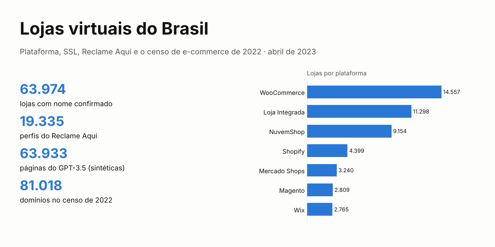
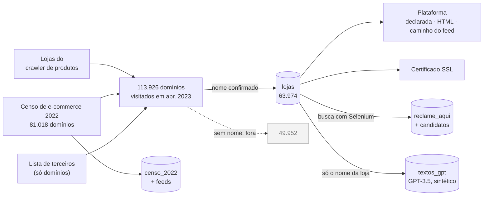
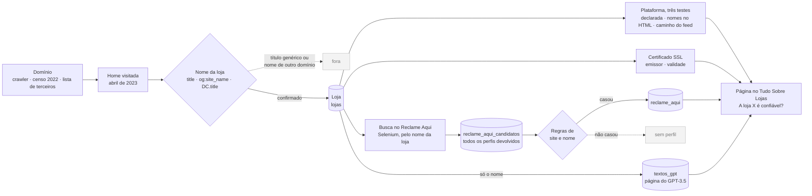
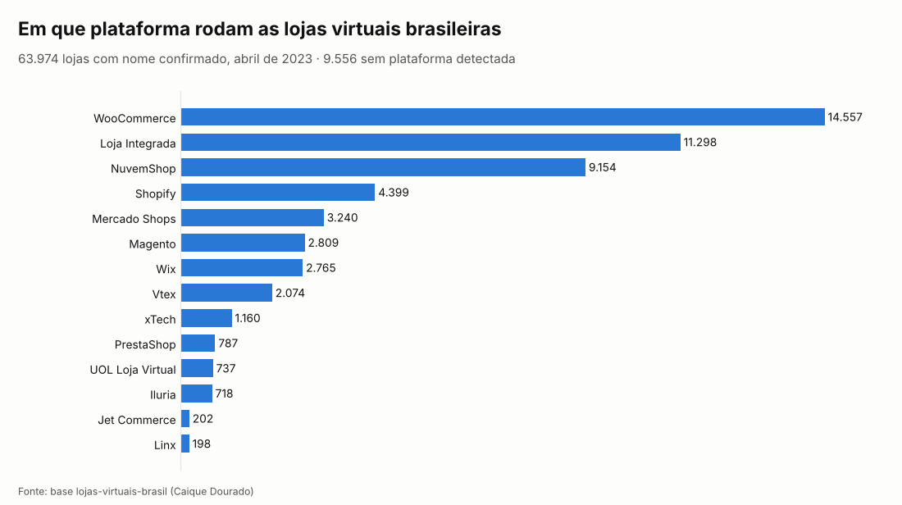
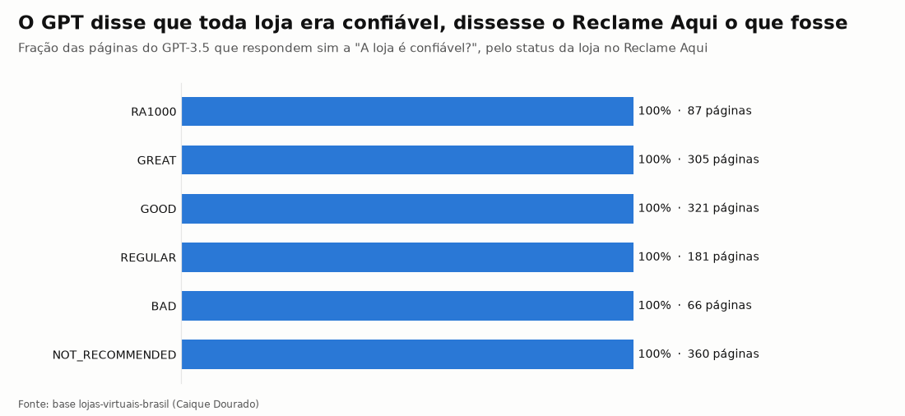

# Lojas virtuais do Brasil

[](https://github.com/CaiqueDourado/lojas-virtuais-brasil/actions/workflows/validate.yml)
[](LICENSE-DATA.md)
[](LICENSE)
[](https://www.kaggle.com/datasets/caiquedourado/lojas-virtuais-brasil)

[Read in English](README.md) · [O site arquivado](https://web.archive.org/web/20250618081809/https://tudosobrelojas.com/a-loja-saboreat-e-confavel-tudo-sobre-a-loja-saboreat/)



São **63.974 lojas virtuais brasileiras**, encontradas e checadas em abril de 2023. De cada uma, a base traz
domínio, plataforma de e-commerce, tamanho do catálogo, certificado SSL e reputação no Reclame Aqui.

A base também traz:

- o **censo de e-commerce de 2022**, com 81.018 domínios e os feeds de produtos deles;
- as **63.933 páginas que o GPT-3.5 escreveu** sobre as lojas. Elas registram o que um modelo de linguagem diz
  quando não sabe nada sobre o assunto.

## O site: tudosobrelojas.com (2023)

[](https://web.archive.org/web/20250618081809/https://tudosobrelojas.com/a-loja-saboreat-e-confavel-tudo-sobre-a-loja-saboreat/)

*Tudo Sobre Lojas, [arquivado no Wayback Machine](https://web.archive.org/web/20250618081809/https://tudosobrelojas.com/a-loja-saboreat-e-confavel-tudo-sobre-a-loja-saboreat/).*

Em 2023 o autor mantinha o **Tudo Sobre Lojas**, um site com uma página por loja virtual brasileira, cada uma
respondendo "A loja X é confiável?". Esta base é o banco de dados do site.

| Parte | Como funcionava | Nesta base |
|---|---|---|
| Páginas | Uma por loja: é confiável, é segura, benefícios, pagamento e frete, cupons, rastreamento, atendimento | Texto em `textos_gpt` |
| Plataforma | Identificação da plataforma (Shopify, VTEX, WooCommerce, NuvemShop…) por três testes | `lojas.plataforma`, `sinais_no_html`, feeds do censo |
| Segurança | Certificado SSL checado em toda loja | `certificado_*` |
| Reputação | Perfil do Reclame Aqui achado por uma busca com Selenium, e links para buscar a loja no Consumidor.gov.br, no Jusbrasil e no Reclame Aqui | `reclame_aqui`, `reclame_aqui_candidatos` |
| Evidência visual | Screenshots da home da loja e da página dela no Reclame Aqui, tirados com C# e Selenium | Não (imagens) |
| Dados da empresa | CNPJ lido do WHOIS e cruzado com a base da Receita Federal (razão social, CNAE, endereço, sócios, contatos) | Não (dados pessoais) |
| Texto | Escrito pelo GPT-3.5 a partir do nome da loja | Sim, marcado como sintético |

## Arquivos

| Arquivo | Linhas | O que tem |
|---|---:|---|
| `lojas` | 63.974 | domínio, nome, plataforma, sinais da plataforma no HTML, produtos no feed, SSL, status e nota no Reclame Aqui |
| `plataformas` | 13 | plataformas do leitor de feeds de produtos do autor |
| `reclame_aqui` | 19.335 | o perfil do Reclame Aqui ligado a cada loja: status, nota, reclamações, percentual resolvido |
| `reclame_aqui_candidatos` | 217.507 | todos os perfis que a busca do Reclame Aqui devolveu, com o escolhido |
| `textos_gpt` | 63.933 | páginas "A loja X é confiável?" do GPT-3.5, de 12/04/2023: **sintéticas, não são fatos** |
| `censo_2022` | 81.018 | censo de 2022: plataforma declarada, duas checagens de online, URL do feed, id do Mercado Shops |
| `censo_2022_feeds` | 20.284 | feeds testados nos domínios do censo e produtos lidos |
| `feeds_importados` | 13.804 | feeds de lojas importados no crawler de produtos do autor |

Os arquivos completos (Parquet) estão no [Kaggle](https://www.kaggle.com/datasets/caiquedourado/lojas-virtuais-brasil), com um [notebook de análise](https://www.kaggle.com/code/caiquedourado/notebook-lojas-virtuais-brasil).
Este repositório tem os scripts, a documentação e a pasta `sample/`, com todas as linhas de 500 lojas sorteadas
e amostras do censo e dos feeds.

## Um olhar nos dados

**Uma loja em todas as tabelas**, `estrela10.com.br` (`id_loja` 11187), da pasta `sample/`:

| Tabela | O que tem desta loja |
|---|---|
| `lojas` | nome "Estrela 10", plataforma Linx, 5.178 produtos no feed, certificado Let's Encrypt válido até 03/07/2023, Reclame Aqui RA1000 com nota 8,8, perfil `estrela10` |
| `reclame_aqui` | perfil `estrela10`: 866 reclamações, 95,4% resolvidas, status RA1000 |
| `reclame_aqui_candidatos` | todos os perfis que a busca por "Estrela 10" devolveu, com `escolhido = true` no que ficou |
| `textos_gpt` | a página que o GPT-3.5 escreveu em 12/04/2023 (trecho abaixo) |

> **A loja Estrela 10 é confiável?**
> Sim, a loja Estrela 10 é confiável. A loja tem um alto índice de avaliações positivas por parte de seus
> clientes. […]

O modelo recebeu só o nome da loja. O ano de fundação que a página dá (2008) e o "alto índice de avaliações
positivas" não vêm de fonte nenhuma. Aqui o Reclame Aqui por acaso concorda; o modelo diz o mesmo das 360 lojas
que o Reclame Aqui não recomenda.

**Feeds achados pelo censo de 2022** (`censo_2022` + `censo_2022_feeds`):

| Domínio | Plataforma declarada | Feed que respondeu | Produtos |
|---|---|---|---:|
| uniformes25.com.br | NuvemShop | `…/tiendanube/stores/…/fb_catalog.xml` | 111 |
| solshine.com.br | Shopify | `/products.json` | 362 |
| obeleza.com.br | Mercado Shops | `mercadoshops.com.br/darwin/rss/150043409/gshopping` | 919 |
| cyclone.com.br | Vtex | `/XMLData/googleshopping.xml` | 582 |

## Em números

| Status no Reclame Aqui | Lojas | Nota média |
|---|---:|---:|
| RA1000 | 88 | 8,95 |
| GREAT | 309 | 8,52 |
| GOOD | 325 | 7,45 |
| REGULAR | 182 | 6,53 |
| BAD | 67 | 5,49 |
| NOT_RECOMMENDED | 366 | 3,98 |
| UNDER_REVIEW | 19 | |
| NO_INDEX (poucas reclamações para ter nota) | 17.320 | |
| sem perfil encontrado | 45.298 | |

- **Domínios:** 61.129 lojas em `.com.br`, 2.250 em `.com`, algumas centenas em outras terminações.
- **Certificados:** 53.668 lojas tinham certificado SSL em abril de 2023.
- **Tamanho do catálogo:** 6.749 lojas têm o número de produtos lido do feed.
- **Censo de 2022:** 81.018 domínios; 78.295 responderam às duas checagens e 2.406 falharam nas duas; 55.707
  também estão em `lojas`.
- **Produtos lidos dos feeds do censo:** 14,6 milhões, a maioria do Mercado Shops (8,5 milhões), NuvemShop
  (3,1 milhões), Vtex (1,2 milhão) e Shopify (1,0 milhão).
- **Páginas do GPT:** 63.933; 63.538 respondem "sim, é confiável", 4 respondem não, 391 sem resposta legível.

## Como foi feito

De onde vieram os domínios e o que virou deles:



O que aconteceu com cada loja em abril de 2023:



Passo a passo, com contagens: [metodologia](docs/methodology.md) (em inglês).

## Plataformas



WooCommerce, Loja Integrada e NuvemShop rodam mais da metade das lojas com plataforma conhecida.

A plataforma foi lida de três jeitos:

1. a declarada nas listas de origem;
2. nomes de plataforma achados no HTML (`sinais_no_html`);
3. um caminho de feed conhecido que respondeu (`fb_catalog.xml` da NuvemShop, `products.json` da Shopify,
   `/darwin/rss/{id}/gshopping` do Mercado Shops…).

Esses testes viraram o `PlatformDetector` da [BrCommerceKit](https://github.com/CaiqueDourado/BrCommerceKit).

## Reclame Aqui

Para cada loja com página no site do autor, um navegador buscou o nome dela no Reclame Aqui, o principal site
de reclamações de consumidores do Brasil, e guardou todos os perfis devolvidos. Regras de casamento por nome e
site escolheram o perfil da loja.

18.676 lojas ganharam um perfil, mas 17.320 delas são NO_INDEX: pequenas demais para ter nota. Nas 1.337 lojas
com nota, a média vai de 3,98 (NOT_RECOMMENDED) a 8,95 (RA1000).

O casamento pode errar em nomes comuns. O [relatório de qualidade](docs/data-quality.md) explica como conferir.

## O que o GPT disse sobre elas

O site Tudo Sobre Lojas, do autor ([Web Archive](https://web.archive.org/web/20250618081809/https://tudosobrelojas.com/a-loja-saboreat-e-confavel-tudo-sobre-a-loja-saboreat/)),
tinha uma página por loja. Cada página foi escrita pelo GPT-3.5 só a partir do nome da loja, com os
intertítulos "A loja X é confiável?" e "A loja X é segura?".

Das 63.542 páginas com resposta legível, 63.538 dizem que sim. Isso inclui todas as 1.320 páginas sobre lojas
avaliadas pelo Reclame Aqui, até as 360 que ele não recomenda. A maioria inventa ano de fundação, cidade, percentual de avaliações
positivas ou reputação no Reclame Aqui.

Os textos estão publicados porque mostram, em escala e ao lado de dados reais de reputação, como um modelo
preenche uma lacuna com texto confiante. Use a tabela `textos_gpt` para isso, nunca como informação sobre uma
loja.



## Como usar

```python
import pandas as pd

lojas = pd.read_csv("sample/lojas_sample.csv")
lojas.plataforma.value_counts().head(10)

# lojas com nota e sua plataforma
lojas.dropna(subset=["reclame_aqui_nota"]).groupby("plataforma").reclame_aqui_nota.agg(["count", "mean"])
```

```sql
-- DuckDB, arquivos completos do Kaggle: o que o GPT respondeu sobre lojas que o Reclame Aqui não recomenda
SELECT l.nome, l.reclame_aqui_nota, substr(t.texto, strpos(t.texto, 'confi'), 120) AS resposta
FROM 'lojas.parquet' l JOIN 'textos_gpt.parquet' t USING (id_loja)
WHERE l.reclame_aqui_status = 'NOT_RECOMMENDED' LIMIT 10;
```

Cada coluna está no [dicionário de dados](docs/data-dictionary.pt-BR.md) ([EN](docs/data-dictionary.md)). Como a
base foi montada está na [metodologia](docs/methodology.md), em inglês.

## Privacidade

Publicado: o que a loja mostra a qualquer pessoa (domínio, nome, plataforma, certificado) e a reputação pública
das empresas.

Não publicado:

- sócios das empresas;
- listas de contato;
- WHOIS bruto;
- o campo de CNPJ/CPF dos perfis do Reclame Aqui (o MEI usa o próprio CPF);
- as metatags de autor e copyright, que costumam trazer nome de pessoa.

Donos de loja podem pedir a remoção abrindo uma issue.

## Estrutura do repositório

```text
sample/        todas as linhas de 500 lojas sorteadas; amostras do censo e dos feeds (CSV)
schema/        definição das colunas e metadados
scripts/       exportar_lojas.py (SQL Server -> Parquet), perfil_lojas.py, perfil_textos.py, build_lojas.py,
               validate.py, make_figures.py, make_cover.py, docs.py
notebooks/     eda.ipynb
docs/          metodologia, qualidade, dicionário de dados, descrição do Kaggle, imagens
kaggle/        dataset-metadata.json
stats.json     contagens de cada etapa do build
```

## Relacionados

- [BrCommerceKit](https://github.com/CaiqueDourado/BrCommerceKit): detecção de plataforma e leitura de feeds de lojas brasileiras.
- [scrapladder](https://github.com/CaiqueDourado/scrapladder): baixa páginas do HTTP comum até o navegador, aprendendo por domínio qual método funciona.
- [DomainCheck](https://github.com/CaiqueDourado/DomainCheck): se um domínio está livre (DNS, Registro.br, WHOIS).
- [brazilian-ecommerce-products](https://github.com/CaiqueDourado/brazilian-ecommerce-products): produtos e preços coletados de 17.899 lojas brasileiras.
- [portuguese-product-reviews](https://github.com/CaiqueDourado/portuguese-product-reviews): 2,87 milhões de reviews de produtos de lojas brasileiras.

## Licença

A compilação e as colunas derivadas estão em [CC BY 4.0](LICENSE-DATA.md). Código: [MIT](LICENSE).

## Autor

**Caique Dourado**: 20 anos construindo crawlers, pipelines de dados e SEO programático em .NET e SQL Server. Mais em [github.com/CaiqueDourado](https://github.com/CaiqueDourado).
