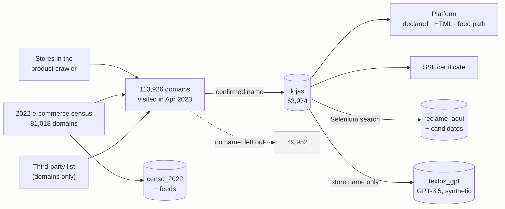
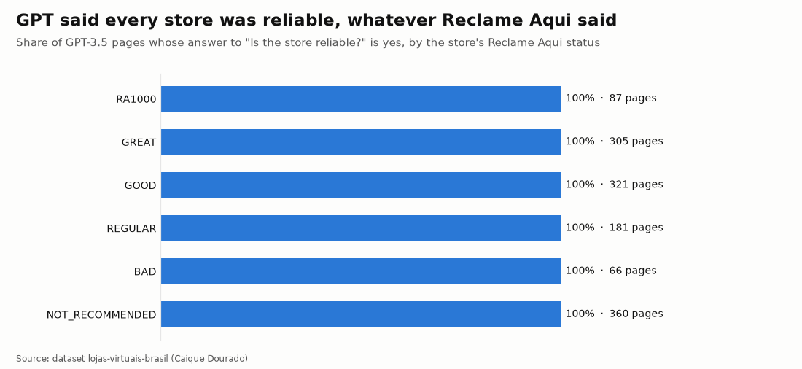

# Methodology

How the stores were found, how each column was read, and what was changed to publish them. Counts come
from `stats.json`.



## 1. Finding the stores (2019–2023)

The author's product crawler (from 2019) needed store feeds, and his site **Tudo Sobre Lojas**
(tudosobrelojas.com, April 2023, "A loja X é confiável?") needed a page per store. The domains came from three
places:

- the **stores already in the crawler** (`fontes_no_crawler` counts how many of its sources point to each domain);
- the **2022 e-commerce census** (`censo_2022`): 81,018 domains with a declared platform, each checked twice
  for being online, with its product feed searched (`censo_2022_feeds`) and, for Mercado Shops, the store id
  read from the HTML;
- a **third-party list of Brazilian e-commerce domains**. Only the domain was used; the list's other fields
  (company data, contacts, partners) are not in this dataset.

In April 2023 the domains were visited for the site. The crawler stored 113,926 domains; **63,974** got a confirmed,
non-repeated store name, and those are the stores of this dataset. The other 49,952 (no confirmed name:
offline, parked, only a generic title, or a name shared with another domain) are left out.

## 2. Platform: three tests

| Test | How | Column |
|---|---|---|
| Declared | the platform listed for the domain in the source lists | `plataforma`, `plataforma_original` |
| Text in the HTML | platform names found in the home page or robots.txt ("woocommerce", "lojaintegrada", "nuvemshop"…) | `sinais_no_html` |
| Feed path | a known feed path answered with a valid feed: NuvemShop `fb_catalog.xml`, Shopify `products.json`, VTEX `XMLData/*.xml`, Magento `amfeed`, Mercado Shops `/darwin/rss/{id}/gshopping`… | `censo_2022.url_feed`, `plataforma_feed`, `censo_2022_feeds`, `total_produtos` |

Spellings were unified for the release ("Nuvem Shop" and "NuvemShop" → NuvemShop; "Loja Integrada PRO" →
Loja Integrada; "Xtech" → xTech); the stored value stays in `plataforma_original`. The same tests are now the
`PlatformDetector` of [BrCommerceKit](https://github.com/CaiqueDourado/BrCommerceKit).

## 3. Store name

Five places in the page were read in two decodings (UTF-8 and ASCII): `<title>`, `og:site_name`,
`DC.title`, author and copyright tags. Titles that name a platform or a placeholder ("Loja virtual", "Home",
"Minha loja"…, 186 in the author's list) were skipped, and a name used by more than one domain was marked
and left out. The release fixes HTML entities and UTF-8 read as Latin-1 in 3,034 names ("TechAudio &#8211",
"Peças"). The author and copyright tags are not published because they often carry people's names.

## 4. SSL certificate

The certificate of each https domain was read in April 2023: the domain it was issued to, the authority and
the expiry date. 53,668 stores had one; Let's Encrypt issued most of them.

## 5. Reclame Aqui

For each store with a page on Tudo Sobre Lojas, a Selenium-driven browser searched the store's name on
Reclame Aqui (reclameaqui.com.br), Brazil's main consumer complaint site, and stored every profile the search
returned (`reclame_aqui_candidatos`: 217,507 for 24,427 stores). A cascade of matching rules on name and
website chose the profile of the store (`reclame_aqui`: 19,335 rows, 18,676 stores). The
`documents` field of the profiles (CNPJ, and CPF for individual micro-entrepreneurs) is not published.

Most stores are small: 17,320 of the linked profiles are `NO_INDEX`, Reclame Aqui's status for companies
with too few complaints to be rated.

## 6. The GPT pages

On 12 April 2023 the author's crawler asked GPT-3.5 to write one page per store, with a fixed outline:
introduction and history, "A loja X é confiável?", "A loja X é segura?", benefits, payment and shipping,
coupons, then links to coupon sites. The prompt was built from the store name; no data about the store was given to the model. The 63,933 pages are in
`textos_gpt`, linked to the store by name (63,930 matches).

They are published as a record of what a 2023 language model writes when it knows nothing about the subject:
every page answers that the store is reliable and safe, and most invent a founding year, a city, a
percentage of positive reviews or a Reclame Aqui reputation. **Do not read them as information about the
stores.** Against Reclame Aqui: all 1,320 pages about rated stores say yes, the 360 not recommended included.



## 7. Release

`scripts/exportar_lojas.py` reads only the columns listed in it, so partners, the third-party list's fields,
raw WHOIS, the Reclame Aqui documents and the author tags never leave the database. `scripts/build_lojas.py`
builds the tables:

```bash
pip install pyodbc pyarrow duckdb pandas
python scripts/exportar_lojas.py --out D:/lojas_raw         # SQL Server -> Parquet (resumable)
python scripts/perfil_lojas.py --raw D:/lojas_raw            # profile
python scripts/build_lojas.py --raw D:/lojas_raw --out D:/lojas_out
python scripts/validate.py --full D:/lojas_out/kaggle
python scripts/make_figures.py --data D:/lojas_out/kaggle
python scripts/docs.py
```
